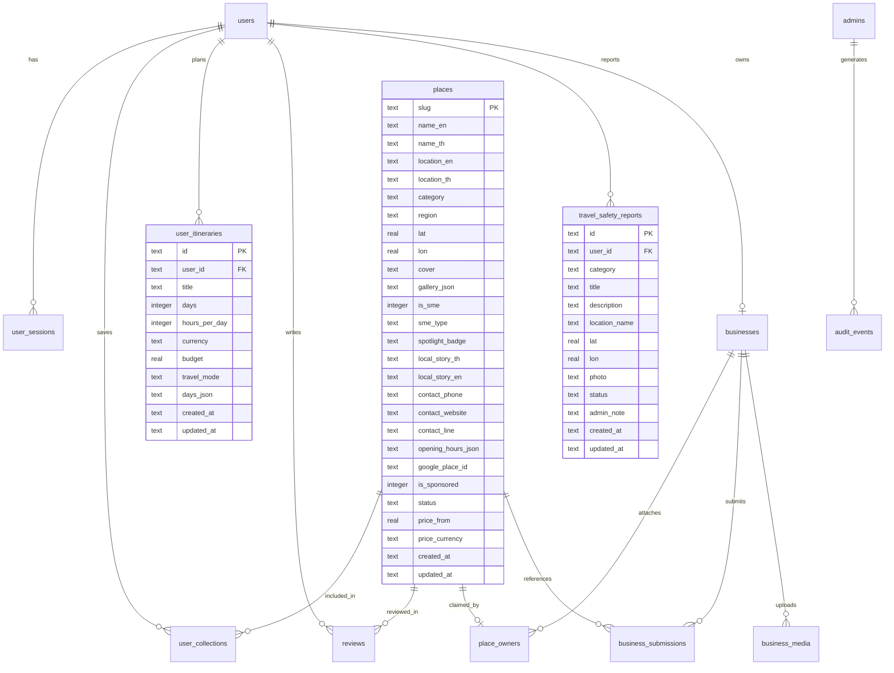

# Traval Platform — System Architecture & Backend Specifications
**ผู้รับผิดชอบ:** Prom (Backend Development / Database / API / System Architecture)  
**โปรเจกต์:** Traval (Travel & Local Discovery Platform)  
**เวอร์ชันระบบ:** Backend v2.8 (Traval Core MVP)  
**วันที่อัปเดต:** 21 ตุลาคม 2569  

---

## 1. บทสรุปการวิเคราะห์สเปกและความต้องการระบบ (Executive Summary)

จากเอกสารข้อกำหนด `Traval_Requirements_Business_Updated.txt` และ Action Plan สรุปภาพรวมและสถาปัตยกรรมทางเทคนิคของแพลตฟอร์ม Traval ดังนี้:

1. **Local-First & Light Footprint Architecture:**
   - ใช้ Node.js Native Runtime (>= 22.14 LTS) โดยไม่ต้องพึ่งพา 3rd-party npm packages ภายนอก ทำให้ระบบทำงานได้รวดเร็ว เบา และปลอดภัย
   - ฐานข้อมูลใช้ SQLite (`node:sqlite`) ในโหมด `WAL (Write-Ahead Logging)` พร้อม `foreign_keys=ON` และ Snapshot Backup ด้วย `VACUUM INTO`
   - จัดเก็บข้อมูลจริงแยกต่างหากที่ `%LOCALAPPDATA%\unfold-travel\data\`
2. **SME First & Local Discovery Core:**
   - รองรับการระบุร้านค้าชุมชน/วิสาหกิจชุมชน (`is_sme`, `sme_type`, `spotlight_badge`, `local_story_th`, `local_story_en`, `contact_phone`, `contact_line`)
   - รองรับการค้นหาพิกัดรอบตัว (**Around Me**) พร้อมตัวกรอง `localOnly=1` และรัศมีละเอียด (300m, 500m, 1km, 3km, 5km)
   - แยกร้านที่จ่ายโปรโมต (`is_sponsored`) ออกจากผลการค้นหาธรรมชาติอย่างชัดเจน
3. **Travel Safety & Scam Reports:**
   - ระบบรายงานจุดเสี่ยงและเหตุการณ์หลอกลวงนักท่องเที่ยว (เช่น โก่งค่าโดยสาร, แท็กซี่ไม่กดมิเตอร์, จุดอันตราย)
   - ข้อมูลต้องผ่านการตรวจสอบจาก Admin (`status = 'pending' -> 'verified'`) ก่อนนำมาปักหมุดแจ้งเตือนบนแผนที่สาธารณะ
4. **Data Protection & Privacy (PDPA):**
   - ไม่บันทึกหรือเก็บประวัติตำแหน่งพิกัดสดของผู้ใช้ลง Database (ค้นหาแบบ Stateless ผ่าน Query Params)
   - รหัสผ่านเข้ารหัสด้วย `scrypt` + Salt และ Token เข้ารหัส SHA-256

---

## 2. System Architecture Diagram

```mermaid
graph TD
    subgraph Frontend_Clients [Frontend Clients & Apps]
        TravelerApp["Traveler Web App (apps/traveler/ & traval-user-frontend/)\n[Moo Scope: Discover / Map / Around Me / Collections]"]
        PlannerApp["Trip Planner (apps/planner/)\n[Moo/Nine: Manual / Auto Trips]"]
        AdminApp["Admin CMS & Dashboard (apps/admin/)\n[Nine: Places / Reviews / Safety / Audit / Stats]"]
        BusinessApp["Business Portal (apps/business/)\n[Nine: SME Registration / Place Submissions]"]
    end

    subgraph Backend_Core [Traval Backend Engine (server.js)]
        Router["HTTP Request Router & Host/Origin Guard"]
        AuthModule["Auth & Session Controller\n(Users, Admins, Scrypt, SameSite Cookies)"]
        PlaceEngine["Place & Local SME Engine\n(Nearby Radius, Spotlight, Category Filter)"]
        SafetyEngine["Travel Safety & Scam Moderation Engine"]
        TripEngine["Trip Planner & Stopover Engine"]
        BusinessEngine["Business Registration & Verification Engine"]
        AuditEngine["Append-only Administrative Audit Trail"]
    end

    subgraph Data_Storage [Persistent Storage (%LOCALAPPDATA%)]
        SQLiteDB[(SQLite Database\nWAL Mode, Foreign Keys)]
        MediaUploads["File Storage\n/uploads/ (Places)\n/review-media/ (Reviews)\n/safety-media/ (Safety Evidence)"]
        Backups["Atomic Backups\n(VACUUM INTO + SHA256 Manifest)"]
    end

    TravelerApp --> Router
    PlannerApp --> Router
    AdminApp --> Router
    BusinessApp --> Router

    Router --> AuthModule
    Router --> PlaceEngine
    Router --> SafetyEngine
    Router --> TripEngine
    Router --> BusinessEngine
    Router --> AuditEngine

    AuthModule --> SQLiteDB
    PlaceEngine --> SQLiteDB
    SafetyEngine --> SQLiteDB
    SafetyEngine --> MediaUploads
    TripEngine --> SQLiteDB
    BusinessEngine --> SQLiteDB
    AuditEngine --> SQLiteDB
    SQLiteDB --> Backups
```

---

## 3. Database Schema & ER Diagram



---

## 4. ตารางข้อมูลหลัก (Database Tables Specification)

### 4.1 ตาราง `places` (สถานที่ & ร้านค้าชุมชน Local SME)
| คอลัมน์ | ชนิดข้อมูล | คำอธิบาย |
|---|---|---|
| `slug` | TEXT PK | รหัสเฉพาะของสถานที่ (URL-safe string) |
| `name_en` / `name_th` | TEXT | ชื่อภาษาอังกฤษ และภาษาไทย |
| `location_en` / `location_th` | TEXT | ที่ตั้งภาษาอังกฤษ และภาษาไทย |
| `category` | TEXT | หมวดหมู่ (`nature`, `food`, `stay`, `culture`) |
| `region` | TEXT | ภูมิภาค (`north`, `south`, `central`, `northeast`, `east`, `west`) |
| `lat` / `lon` | REAL | พิกัดละติจูด และลองจิจูดสำหรับปักหมุด |
| `cover` | TEXT | URL ภาพหน้าปกหลัก |
| `gallery_json` | TEXT | JSON Array ของภาพเพิ่มเติม (สูงสุด 8 ภาพ) |
| `price_from` / `price_currency`| REAL / TEXT | ราคาเริ่มต้น และสกุลเงิน (`THB`) |
| `is_sme` | INTEGER (0/1) | **[ใหม่]** ระบุว่าเป็นร้านค้าชุมชน / Local SME หรือไม่ |
| `sme_type` | TEXT | **[ใหม่]** ประเภทร้าน SME (`local_food`, `cafe`, `market`, `handicraft`, `experience`) |
| `spotlight_badge` | TEXT | **[ใหม่]** ป้ายแนะนำพิเศษ (`Local Pick`, `Hidden Gem`, `New Local Shop`) |
| `local_story_th` / `local_story_en` | TEXT | **[ใหม่]** เรื่องราววิถีชุมชน / จุดเด่นของสินค้าหรือร้านค้า |
| `contact_phone` / `contact_line` | TEXT | **[ใหม่]** ข้อมูลติดต่อร้านค้า |
| `opening_hours_json` | TEXT | **[ใหม่]** เวลาเปิด-ปิดของร้าน |
| `google_place_id` | TEXT | **[ใหม่]** Google Place ID (ถ้ามี) |
| `is_sponsored` | INTEGER (0/1) | **[ใหม่]** ระบุว่าเป็นตำแหน่งโฆษณาหรือไม่ |
| `status` | TEXT | สถานะการเผยแพร่ (`published` / `draft`) |

### 4.2 ตาราง `travel_safety_reports` (รายงานความปลอดภัยและจุดเสี่ยง)
| คอลัมน์ | ชนิดข้อมูล | คำอธิบาย |
|---|---|---|
| `id` | TEXT PK | UUID ประจำรายการรายงาน |
| `user_id` | TEXT FK | อ้างอิงบัญชีผู้รายงาน (`users.id`) |
| `category` | TEXT | ประเภท (`overcharging`, `transport`, `scam`, `danger`, `other`) |
| `title` | TEXT | หัวข้อรายงานเหตุการณ์ |
| `description` | TEXT | รายละเอียดพฤติการณ์ |
| `location_name` | TEXT | ชื่อสถานที่หรือย่านเกิดเหตุ |
| `lat` / `lon` | REAL | พิกัดจุดเกิดเหตุบนแผนที่ |
| `photo` | TEXT | รูปถ่ายหลักฐาน (ถ้ามี) |
| `status` | TEXT | สถานะ (`pending`, `verified`, `rejected`, `resolved`) |
| `admin_note` | TEXT | บันทึกของ Admin หลังการตรวจสอบ |
| `created_at` / `updated_at` | TEXT | วันเวลาสร้างและแก้ไข |

---

## 5. API Contracts & Endpoint Specification

### 5.1 หมวดสถานที่และการค้นหา (Places & SME Discovery)

#### `GET /api/places`
- **สิทธิ์:** สาธารณะ (Public)
- **การทำงาน:** ดึงรายชื่อสถานที่ที่เผยแพร่ทั้งหมด
- **Response:**
  ```json
  {
    "places": [
      {
        "id": "talat-noi-noodle",
        "en": "Talat Noi Noodle",
        "th": "ก๋วยเตี๋ยวตลาดน้อย",
        "category": "food",
        "lat": 13.734,
        "lon": 100.513,
        "isSme": true,
        "smeType": "local_food",
        "spotlightBadge": "Local Pick",
        "localStoryTh": "สูตรโบราณ 60 ปี"
      }
    ]
  }
  ```

#### `GET /api/places/sme?type={type}&spotlight={0|1}&region={region}`
- **สิทธิ์:** สาธารณะ (Public)
- **การทำงาน:** คัดกรองเฉพาะร้าน Local SME สำหรับหน้า Directory หรือหมวดร้านชุมชน
- **Query Params:**
  - `type`: `all` หรือเจาะจง เช่น `local_food`, `cafe`, `market`, `handicraft`
  - `spotlight`: `1` (เฉพาะร้านที่มีป้าย Spotlight)
  - `region`: กรองตามภาค เช่น `north`, `central`

#### `GET /api/places/spotlight`
- **สิทธิ์:** สาธารณะ (Public)
- **การทำงาน:** ดึงร้าน Local SME ที่ได้รับคัดเลือกเป็น Spotlight สำหรับแถบแสดงผลพิเศษ (Spotlight Rail) บนหน้าแรก

#### `GET /api/places/nearby?lat={lat}&lon={lon}&radiusKm={km}&localOnly={0|1}`
- **สิทธิ์:** สาธารณะ (Public)
- **การทำงาน:** ค้นหาสถานที่รอบพิกัดปัจจุบันของผู้ใช้
- **Query Params:**
  - `lat`, `lon`: พิกัดปัจจุบันของผู้ใช้ (จาก Browser GPS)
  - `radiusKm`: รัศมีค้นหา เช่น `0.3`, `0.5`, `1`, `3`, `5`, `25`
  - `localOnly`: `1` เพื่อแสดงเฉพาะร้านค้าชุมชน Local SME รอบตัว

---

### 5.2 หมวดความปลอดภัยนักท่องเที่ยว (Travel Safety)

#### `POST /api/safety/reports`
- **สิทธิ์:** สมาชิกที่ล็อกอิน (Authenticated User)
- **Request Body:**
  ```json
  {
    "category": "overcharging",
    "title": "Taxi เรียกราคาเหมา 500 บาท",
    "description": "แท็กซี่หน้าสถานีไม่ยอมกดมิเตอร์ เรียกราคาเหมาเกินจริง",
    "locationName": "BTS อโศก สุขุมวิท",
    "lat": 13.737,
    "lon": 100.560,
    "photo": "/safety-media/evidence-uuid.jpg"
  }
  ```
- **Response (201):**
  ```json
  {
    "report": {
      "id": "uuid",
      "status": "pending",
      "createdAt": "2026-10-21T14:00:00Z"
    }
  }
  ```

#### `GET /api/safety/reports`
- **สิทธิ์:** สาธารณะ (Public)
- **การทำงาน:** ดึงรายการจุดเสี่ยงที่ผ่านการอนุมัติแล้ว (`status = 'verified'`) เพื่อนำไปวาดเป็นหมุดเตือนภัยบนแผนที่

#### `GET /api/me/safety-reports`
- **สิทธิ์:** สมาชิกเจ้าของรายงาน
- **การทำงาน:** ติดตามสถานะรายงานของตนเอง (`pending`, `verified`, `rejected`)

#### `GET /api/admin/safety-reports?status={status}`
- **สิทธิ์:** ผู้ดูแลระบบ (Admin)
- **การทำงาน:** เรียกดูรายงานความปลอดภัยทั้งหมดเพื่อตรวจสอบ

#### `PATCH /api/admin/safety-reports/:id`
- **สิทธิ์:** ผู้ดูแลระบบ (Admin)
- **Request Body:**
  ```json
  {
    "status": "verified",
    "adminNote": "ตรวจสอบกับเหตุการณ์ในพื้นที่แล้ว ข้อมูลถูกต้อง"
  }
  ```

    "status": "verified",
    "adminNote": "ตรวจสอบกับเหตุการณ์ในพื้นที่แล้ว ข้อมูลถูกต้อง"
  }
  ```

---

### 5.3 หมวด AI Travel Advisor & Auto Trip Planning (Section 1.1 & 1.5)

#### `POST /api/ai/advisor`
- **สิทธิ์:** สาธารณะ (Public)
- **การทำงาน:** 
  1. รับเงื่อนไขการจัดทริป: `destination`, `days` (1-7), `budget`, `travelers`, `interests`, `travelMode` (driving, walking, transit, taxi), `pace` (relaxed, moderate, packed), `includeSme` (true/false)
  2. จัดกลุ่มสถานที่ตามความสนใจและความใกล้เคียงทางภูมิศาสตร์ (Geographic Clustering)
  3. คัดเลือกร้าน Local SME Stopovers แนะนำระหว่างเส้นทางแต่ละวัน
  4. คำนวณระยะทางรวม ค่าเดินทาง (Taxi / Fuel / Transit), อาหาร, กิจกรรม, และที่พัก
  5. ให้ `groups` สำหรับบันทึกลง My Trips ได้ทันที (`POST /api/me/itineraries`)
  6. รองรับ Quick Walking Query: เมื่อระบุ `userLat`, `userLon` และข้อความระบุการเดิน (เช่น "มีร้านอาหารท้องถิ่นเดิน 10 นาทีไหม") จะคำนวณและแนะนำร้านท้องถิ่นในระยะเดิน 10-15 นาทีทันที
- **Response (200):**
  ```json
  {
    "plan": {
      "type": "auto_trip_plan",
      "title": "ทริปเที่ยวกำแพงเพชร 2 วัน (สไตล์ชิลๆ)",
      "days": 2,
      "travelMode": "driving",
      "totalDistanceKm": 24.5,
      "dailyItinerary": [
        {
          "day": 1,
          "places": [ { "id": "grand-temple", "en": "Grand Temple" } ],
          "distanceKm": 12.3,
          "smeRecommendations": [
            {
              "place": { "id": "talat-noi-noodle", "isSme": true },
              "detourKm": 1.2,
              "estimatedDetourMin": 4
            }
          ]
        }
      ],
      "groups": [["grand-temple"], ["local-market"]],
      "budgetBreakdown": {
        "transport": 250,
        "food": 900,
        "activities": 300,
        "accommodation": 1200,
        "totalEstimated": 2650
      },
      "aiSummary": "จัดแผนการเดินทาง 2 วัน เน้นวัฒนธรรมและอาหาร..."
    }
  }
  ```

---

### 5.4 หมวด Spotlight, แคมเปญ และสถิติ SME (Section 1.7, 2.2, 2.9)

#### `GET /api/campaigns`
- **สิทธิ์:** สาธารณะ (Public)
- **การทำงาน:** ดึงรายการแคมเปญ / Spotlight Banners ที่กำลังแสดงผล (สถานะ `published` และอยู่ในช่วงวันเวลาที่กำหนด)

#### `POST /api/analytics/event`
- **สิทธิ์:** สาธารณะ (Public - Stateless Event Tracking ตามหลัก PDPA)
- **Request Body:**
  ```json
  {
    "placeSlug": "talat-noi-old-noodle-house",
    "eventType": "view" // 'view' | 'direction' | 'phone' | 'website' | 'favorite' | 'add_trip' | 'sme_impression'
  }
  ```

#### `GET /api/admin/sme-stats`
- **สิทธิ์:** ผู้ดูแลระบบ (Admin)
- **การทำงาน:** สรุปตัวชี้วัดประสิทธิภาพของร้าน SME (Impressions, Views, Directions, Trip Adds, Contacts)

#### `GET /api/admin/campaigns` / `POST` / `PUT` / `DELETE`
- **สิทธิ์:** ผู้ดูแลระบบ (Admin)
- **การทำงาน:** ระบบ CMS จัดการแคมเปญ แบนเนอร์โปรโมตร้าน SME และ Local Spotlight

---

### 5.5 หมวดจัดการผู้ใช้และ PDPA Compliance (Section 1.6 & 2.4)

#### `GET /api/admin/users`
- **สิทธิ์:** ผู้ดูแลระบบ (Admin)
- **Query Params:** `?q=somchai&status=active|suspended|all`
- **การทำงาน:** ดูรายชื่อผู้ใช้ ค้นหา ตรวจสอบจำนวนรีวิว ทริป และรายงานความปลอดภัย

#### `PATCH /api/admin/users/:id/status`
- **สิทธิ์:** ผู้ดูแลระบบ (Admin)
- **Request Body:** `{ "status": "suspended", "note": "ฝ่าฝืนเงื่อนไข" }`
- **การทำงาน:** ระงับบัญชีผู้ใช้ โดยผู้ใช้ที่ถูกระงับจะได้รับ HTTP 403 ทันทีในทุก Endpoint ที่ต้องล็อกอิน

#### `DELETE /api/me/account`
- **สิทธิ์:** สมาชิกที่ล็อกอิน (User)
- **การทำงาน:** ขอปิดบัญชีและลบข้อมูลส่วนบุคคลอย่างถาวร (Right to Erasure ตาม PDPA) ระบบจะลบข้อมูลบัญชีและลบข้อมูลที่เชื่อมโยงแบบ Cascade อัตโนมัติ

---

### 5.6 หมวดสถิติและภาพรวมระบบ (Admin Analytics & Stats)

#### `GET /api/admin/stats`
- **สิทธิ์:** ผู้ดูแลระบบ (Admin)
- **การทำงาน:** สรุปตัวเลขสถิติจริงจากฐานข้อมูลทั้งหมด
- **Response (200):**
  ```json
  {
    "stats": {
      "totalUsers": 120,
      "totalPlaces": 45,
      "publishedPlaces": 40,
      "smePlaces": 18,
      "totalReviews": 89,
      "pendingReviews": 3,
      "pendingSubmissions": 2,
      "pendingSafetyReports": 1,
      "verifiedSafetyReports": 5,
      "totalItineraries": 34,
      "categories": [
        { "category": "food", "count": 20 },
        { "category": "stay", "count": 10 }
      ]
    }
  }
  ```

---

## 6. แผนการผสานการทำงานกับเพื่อนร่วมทีม (Cross-Team Integration)

1. **สำหรับ Moo (UX/UI User / Map / Spotlight):**
   - สามารถเรียก `GET /api/places/spotlight` เพื่อนำข้อมูลไป render ลงแถบ **Local SME Spotlight Rail**
   - หน้าแผนที่ Around Me สามารถส่งพารามิเตอร์ `localOnly=1` และ `radiusKm=0.5` เพื่อให้สอดคล้องกับตัวเลือก 300m / 500m / 1km / 3km / 5km
   - สามารถดึงหมุดเตือนภัยจาก `GET /api/safety/reports` ไปแสดงเป็น Warning Icon บนแผนที่
   - สามารถเรียก `POST /api/ai/advisor` เพื่อแสดงคำแนะนำแบบ AI หรือ Quick Walking Recommendations
   - เมื่อผู้ใช้กดดูร้าน SME, กดนำทาง หรือเพิ่มลงทริป ส่ง Event มาที่ `POST /api/analytics/event`
2. **สำหรับ Nine (Admin / Business / Trips):**
   - หน้า Admin Dashboard สามารถเรียก `GET /api/admin/stats` และ `GET /api/admin/sme-stats`
   - หน้า Moderation มี API ตรวจสอบ Travel Safety (`/api/admin/safety-reports`), User Management (`/api/admin/users`), และ CMS แคมเปญ (`/api/admin/campaigns`)
3. **สำหรับ Tommy (Google Integration & Testing):**
   - ช่องทางเก็บพิกัดและ `google_place_id` บน SQLite พร้อมรองรับการเชื่อมโยง Google Place ID และ Google Directions URL
   - ชุดทดสอบอัตโนมัติ `tests/` พร้อม 13 Suites ผ่าน 100%

---

## 7. ผลการทดสอบทางเทคนิค (Test & Readiness Report)

- **ชุดทดสอบอัตโนมัติ (`npm test`):**
  - จำนวนการทดสอบ: 13 / 13 Suites **PASS 100%**
  - ครอบคลุมการทดสอบ SME Directory, Spotlight, Nearby localOnly, Travel Safety Lifecycle, AI Advisor, Campaigns, Analytics Events, User Management, และ Account Deletion
- **ระบบสำรวจความพร้อม (`node doctor.js`):**
  - Node.js Runtime Check: **PASS**
  - SQLite Integrity Check: **PASS**
  - Foreign Key Constraints: **PASS (0 violations)**
  - Local Data Check: **PASS**

