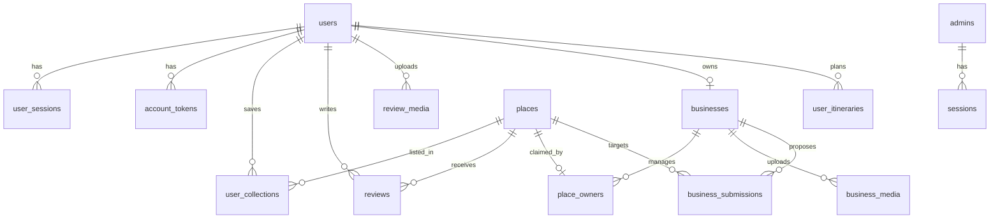

# Prom — Backend สัปดาห์ที่ 1–2 (19 ตุลาคม 2026)

ผู้รับผิดชอบ: **Prom** (Backend / Database / API / Architecture / Integration / Frontend Testing)  
วันที่ทำ: 19 ตุลาคม 2026  
อ้างอิง: `# Traval — Project Action Plan.txt` ส่วน Prom และ `Traval_Requirements_Business_Updated.txt`  
โค้ดที่รันอยู่ชื่อ unfold v2.7 ผลิตภัณฑ์ในสเปกชื่อ Traval

เอกสารนี้คือของส่งมอบก่อนเริ่มพัฒนาเพิ่ม ทั้งสถาปัตยกรรม สคีมา และสัญญา API อยู่ในไฟล์เดียว

## Technology stack ที่ใช้จริง

| ชั้น | ของที่ใช้ | เหตุผล |
|---|---|---|
| รันไทม์ | Node.js 22.16+ / 24 LTS | ไม่มี dependency ของ npm เซิร์ฟเวอร์เป็นไฟล์ `server.js` |
| HTTP | `node:http` ผูก `127.0.0.1` | เครื่องทดสอบเท่านั้น ยังไม่เปิดออกอินเทอร์เน็ต |
| ฐานข้อมูล | SQLite ผ่าน `node:sqlite` ไฟล์ `unfold.sqlite` | ข้อมูลอยู่เครื่องผู้ใช้ ไม่ใช่ในโฟลเดอร์ซอร์ส |
| รหัสผ่าน | scrypt แยก salt ต่อบัญชี | ไม่เก็บรหัสผ่านดิบ |
| เซสชัน | โทเค็นสุ่ม 64 ไบต์ เก็บเฉพาะ SHA-256 | คุกกี้ HttpOnly, SameSite=Strict |
| ไฟล์รูป | โฟลเดอร์ `uploads/` และ `review-media/` ข้างฐานข้อมูล | จำกัด PNG / JPEG / WebP ไม่เกิน 5 MB |
| แผนที่ตอนนี้ | แผ่นแผนที่ OpenStreetMap ในเบราว์เซอร์ | ยังไม่ใช้ Google Maps จนกว่า Tommy จะสรุปโควตาและคีย์ |
| ระยะทางทริป | Haversine ใน `apps/planner/trip-engine.js` และ `getNearby` | เป็นระยะตรง ไม่ใช่เส้นทางถนน |
| อีเมล | Resend เมื่อตั้ง `UNFOLD_RESEND_API_KEY` + `UNFOLD_EMAIL_FROM` + `UNFOLD_PUBLIC_URL` | ถ้าไม่ตั้งค่า ลิงก์ยืนยันพิมพ์ที่คอนโซลของเซิร์ฟเวอร์ |
| ทดสอบ | `npm test` คือ `node --test tests/*.test.js` | ตรวจ API จริงกับ SQLite ชั่วคราว |

ข้อมูลบน Windows อยู่ที่ `%LOCALAPPDATA%\unfold-travel\data\`

## สถาปัตยกรรม

เบราว์เซอร์สามบทบาทยิงมาที่โปรเซสเดียว

```text
นักท่องเที่ยว  apps/traveler + apps/planner
แอดมิน         apps/admin
ร้านค้า        apps/business
        │  HTTP same-origin, cookie
        ▼
server.js
  ├─ ไฟล์หน้าเว็บ ผ่าน PAGE_FILES (URL เดิมไม่เปลี่ยน)
  ├─ /api/*       JSON
  └─ รูป          uploads / review-media ตามสิทธิ์
        │
        ▼
SQLite + โฟลเดอร์รูป  (ล็อกด้วย server.pid กันเปิดเซิร์ฟเวอร์ซ้ำ)
```

ไม่มีบริการแยกสำหรับ auth, แผนที่ หรือคิวงาน การเพิ่ม Google หรือเกตเวย์จ่ายเงินภายหลังต้องเรียกจากเซิร์ฟเวอร์เท่านั้น ห้ามใส่คีย์ในไฟล์หน้าเว็บ

## Role และสิทธิ์

บัญชีนักท่องเที่ยวกับบัญชีแอดมินคนละตาราง ร้านค้าไม่ใช่บัญชีใหม่ เป็นผู้ใช้ที่ผูกแถว `businesses` ได้หนึ่งร้านต่อหนึ่งบัญชี

| บทบาท | เข้าได้ | เข้าไม่ได้ |
|---|---|---|
| ผู้เยี่ยม | สถานที่ `published`, Nearby, รีวิวที่อนุมัติแล้ว | ร่าง, รีวิวค้างตรวจ, ข้อมูลร้านภายใน |
| USER | ของผู้เยี่ยม + โปรไฟล์, คอลเลกชัน, ทริป, ส่งรีวิวเป็น `pending` | อนุมัติรีวิว, แก้สถานที่สาธารณะตรง ๆ |
| BUSINESS | ของ USER + สมัครร้าน, อัปโหลดรูป, ส่งคำขอ create / edit / claim | เผยแพร่เอง, ตั้ง Featured, เห็นร้านของคนอื่น |
| ADMIN | สถานที่ทุกสถานะ, อนุมัติร้านและคำขอ, กลั่นกรองรีวิว, อ่าน Audit | ใช้คุกกี้ผู้ใช้ทั่วไปไม่ได้ และกลับกัน |

คุกกี้แอดมินชื่อ `unfold_admin` อายุ 12 ชั่วโมง และส่งเฉพาะ path `/api/admin`  
คุกกี้ผู้ใช้ชื่อ `unfold_user` อายุ 14 วัน ส่งทั้งไซต์

สถานะร้าน: `pending` → `approved` / `rejected` / `suspended`  
สถานะคำขอร้าน: `draft` → `pending` → `approved` / `rejected`  
สถานะรีวิว: `pending` → `approved` / `rejected`  
สถานที่: `draft` หรือ `published` การเผยแพร่ต้องมีรูปปกและพิกัด

ร้านที่ยังไม่ `approved` สมัครโปรไฟล์ได้ แต่ส่งสถานที่หรืออัปโหลดรูปไม่ได้ เจ้าของต้องยืนยันอีเมลก่อนส่งคำขอ และแอดมินอนุมัติร้านได้เมื่ออีเมลยืนยันแล้ว

## ความปลอดภัยและข้อมูลส่วนบุคคล

- โฮสต์รับเฉพาะ localhost กันการเปิดพอร์ตออกไปโดยไม่ตั้งใจ
- คำขอที่เปลี่ยนข้อมูลตรวจ Origin ให้ตรงกับ Host
- รหัสผ่านอย่างน้อย 12 ตัว มีเพดานความพยายาม 8 ครั้งต่อ 15 นาที
- Audit ไม่เก็บบันทึกรหัสผ่าน โทเค็น หรืออีเมล
- รูปที่ยังไม่เผยแพร่ไม่ถูกเสิร์ฟให้คนทั่วไป แอดมินดูผ่าน `/api/admin/place-media` และ `/api/admin/business-media`
- รูปรีวิวที่ยังไม่อนุมัติเปิดได้เฉพาะเจ้าของรูปหรือแอดมิน
- ไม่มีตารางประวัติ GPS พิกัด Nearby ส่งมาเป็นพารามิเตอร์ของคำขอนั้นแล้วทิ้ง
- สำรองข้อมูลใช้ `backup.js` / `restore.js` พร้อม SHA-256 ไม่ใช่การคัดลอกไฟล์เองขณะเซิร์ฟเวอร์เปิด

สิ่งที่สเปกต้องการแต่ยังไม่ทำ และยังไม่ควรเปิดใน MVP รอบนี้: ล็อกอิน Google / Facebook / OTP, MFA แอดมิน, ลบบัญชีและส่งออกข้อมูล, การจ่ายเงินโฆษณา, การติดตามตำแหน่งเบื้องหลัง

## Deploy, hosting, ที่เก็บไฟล์

สภาพแวดล้อมทดสอบตอนนี้คือเครื่องของทีมผ่าน `START-WINDOWS.cmd`  
ก่อนย้ายออกจาก localhost ต้องมีอย่างน้อย HTTPS, `UNFOLD_PUBLIC_URL`, อีเมลจริง, ดิสก์สำหรับ SQLite และรูป, และงานสำรองนอกเครื่อง แผนสัปดาห์ที่ 10 ของ Prom คือทำจุดนี้หลัง API นิ่ง ไม่ใช่ก่อนมีสัญญา API

รูปไม่เข้า Git อยู่ในโฟลเดอร์ข้อมูลข้างฐานข้อมูล กู้คืนต้องใช้ชุดสำรองที่มี `manifest.json` ของ v2.7

## แนวเชื่อม Google (รอ Tommy)

Tommy เป็นคนศึกษา Maps, Places, Routes, โควตา และทำ POC  
ฝั่ง Prom รับผลเป็นบริการใน `server.js` เท่านั้น

- ปักหมุดบน Traval ใช้ `places.lat` / `places.lon` ที่มีอยู่แล้ว ไม่ต้องมี Google Place ID
- ถ้าเชื่อมร้านบน Google ได้ ค่อยเพิ่มคอลัมน์ Place ID ทีหลังแบบ migration เพิ่มอย่างเดียว
- การนำทางออกไป Google Maps เป็นลิงก์จากพิกัด ไม่ใช่การสร้างร้านบน Google
- คีย์ API อยู่ที่ตัวแปรสภาพแวดล้อมของเซิร์ฟเวอร์

## ลำดับโมดูลสัปดาห์ที่ 3–10

ของในตารางนี้ที่มีใน v2.7 แล้ว ไม่ต้องเขียนใหม่ ให้ทดสอบต่อแล้วเติมช่องที่ยังว่าง

| สัปดาห์ | โมดูล | สถานะในโค้ดตอนนี้ |
|---|---|---|
| W3 | โปรเจกต์, ฐานข้อมูล, สมัครและเข้าสู่ระบบ | มีแล้ว: `server.js`, ตารางผู้ใช้และแอดมิน, คุกกี้แยกกัน |
| W4 | โปรไฟล์, สถานที่, หมวดหมู่ | มีแล้ว: `PATCH /api/me/profile`, CRUD สถานที่, หมวด nature / food / stay / culture |
| W5 | ค้นหา, Nearby, SME, คอลเลกชัน, รีวิว | มี Nearby และรีวิวที่ต้องอนุมัติ ยังไม่มีตัวกรอง Local SME และคอลเลกชันแยกตามจังหวัด |
| W6 | แอดมิน, สมัครร้าน, จัดการร้าน | มีแล้ว: ลงทะเบียนร้าน, คำขอ create / edit / claim, แอดมินอนุมัติ |
| W7 | ทริป, ระยะทาง, งบ, โปรโมตพื้นฐาน | มีแผนทริปและงบก้อนเดียว ยังไม่มีจุดแวะ SME และยังไม่ขายโฆษณา |
| W8 | เชื่อมหน้าเว็บกับ API ร่วมกับ Tommy | หน้าที่มีอยู่เรียก API แล้ว งานนี้คือช่องที่ Tommy ต่อ Google |
| W9 | ทดสอบ API, สิทธิ์, แก้บั๊ก | มี `tests/*.test.js` ต้องเพิ่มเคสของฟีเจอร์ใหม่ทุกครั้ง |
| W10 | เอกสารและสภาพแวดล้อมเดโม | เอกสารนี้อยู่ไฟล์เดียว การเปิดโฮสต์จริงยังไม่ทำ |

ขอบเขตที่แผนทีมให้เลื่อนออกจาก MVP: AI ขั้นสูง, จ่ายเงินซื้อโฆษณาจริง, รายงานรายได้ร้าน

## Database schema

ฐานข้อมูลคือ SQLite ไฟล์ `unfold.sqlite` สคีมาสร้างและเพิ่มคอลัมน์ใน `server.js` ตอนสตาร์ต  
การเปลี่ยนโครงสร้างต้องเป็นการเพิ่มเท่านั้น ห้ามลบตารางหรือข้อมูลผู้ใช้ในขั้นตอนเปิดเซิร์ฟเวอร์



`audit_events` ไม่ผูก foreign key เพื่อให้บันทึกยังอยู่แม้เรคอร์ดต้นทางถูกลบ  
`admins` มีได้แถวเดียว (`id = 1`) และไม่ใช่แถวใน `users`

### users

บัญชีนักท่องเที่ยว และเป็นบัญชีเดียวกับเจ้าของร้าน

| คอลัมน์ | ความหมาย |
|---|---|
| id | UUID |
| name, email | อีเมลไม่ซ้ำ พิมพ์เล็ก |
| salt, password_hash | scrypt |
| email_verified | 0 จนกว่าจะกดลิงก์ยืนยัน บัญชีเก่าที่มาก่อนฟิลด์นี้ได้ค่า 1 |
| created_at | ISO time |

### user_sessions / account_tokens

เซสชันเก็บ `token_hash` ไม่เก็บโทเค็นดิบ อายุ 14 วัน  
โทเค็นยืนยันอีเมลอยู่ 24 ชั่วโมง โทเค็นรีเซ็ตรหัสผ่านอยู่ 30 นาที ใช้แล้วลบ

### places

สถานที่และร้านที่ใช้แสดงบน Home, Map และทริป ใช้ `slug` เป็นรหัสสาธารณะ

| คอลัมน์ | ค่าที่ยอมรับ |
|---|---|
| name_en, name_th, location_en, location_th | สองภาษา ชื่อไทยว่างได้ |
| category | nature, food, stay, culture |
| region | north, south, central, northeast, east, west, world |
| lat, lon | ว่างได้เฉพาะตอนเป็น draft เผยแพร่แล้วต้องมี |
| visit | ข้อความระยะเวลาเข้าชม สูงสุด 40 ตัว |
| description_en, description_th | เรื่องราวสถานที่ |
| cover, gallery_json | รูปปกและแกลเลอรีสูงสุด 8 รูป เป็น path `/uploads/...` |
| featured | 0 หรือ 1 เจ้าของร้านตั้งค่านี้เองไม่ได้ |
| status | draft หรือ published |
| price_from, price_currency | ราคาเริ่มต้น สกุลเงิน THB, USD, EUR, JPY, GBP |

ยังไม่มีฟิลด์ร้าน SME, เวลาเปิดปิด, Google Place ID, หรือป้าย Sponsored ตามสเปก การเพิ่มต้องเป็น `ALTER TABLE` ใหม่ ไม่แก้แถวเดิม

### user_collections

หนึ่งผู้ใช้บันทึกหนึ่งสถานที่ได้สองแบบ: `saved` และ `trip` เรียงด้วย `position` สูงสุด 100 รายการต่อแบบ ยังไม่ใช่คอลเลกชันหลายกล่องตามจังหวัด

### reviews / review_media

หนึ่งผู้ใช้หนึ่งรีวิวต่อหนึ่งสถานที่ คะแนน 1–5 ข้อความ 10–1500 ตัว สถานะเริ่มที่ `pending`  
ไฟล์รูปผูก `owner_id` คนอื่นเห็นรูปได้เมื่อรีวิวนั้น `approved` และสถานที่ `published`

### user_itineraries

แผนของบัญชีนั้นเท่านั้น `days` 1–7, `hours_per_day` 2–12, `travel_mode` เป็น driving, walking หรือ transit  
`days_json` เป็นอาเรย์ของ slug ต่อวัน รวมไม่เกิน 30 สถานที่และห้ามซ้ำ สูงสุด 40 แผนต่อบัญชี  
`budget` เป็นตัวเลขก้อนเดียว ยังไม่แยกค่าน้ำมัน ค่าอาหาร ค่าที่พัก

### businesses / place_owners / business_media / business_submissions

`businesses.owner_id` ไม่ซ้ำ จึงมีได้หนึ่งร้านต่อบัญชี  
ประเภทร้าน: food, stay, experience, other  
สถานะร้าน: pending, approved, rejected, suspended

`place_owners` ผูกหนึ่งสถานที่กับหนึ่งร้าน

`business_submissions.action` เป็น create, edit หรือ claim  
สถานะคำขอ: draft, pending, approved, rejected  
`payload_json` คือข้อมูลสถานที่ที่เสนอ `evidence` ใช้ตอน claim อย่างน้อย 40 ตัวอักษรเมื่อส่งตรวจ  
`base_updated_at` ใช้กันแก้ทับสถานที่ที่แอดมินเพิ่งเปลี่ยน

รูปของร้านใน `business_media` สูงสุด 60 ไฟล์ต่อร้าน และใช้ส่งในคำขอได้เฉพาะรูปของร้านนั้น

### admins / sessions

แอดมินคนเดียว รหัสผ่านตั้งจากรหัสที่เซิร์ฟเวอร์พิมพ์ตอนยังไม่มีแถว `admins` เซสชันอายุ 12 ชั่วโมง

### audit_events

เพิ่มได้อย่างเดียวผ่าน API: เวลา, ชนิดผู้กระทำ, รหัสผู้กระทำ, action, ชนิดเอนทิตี, รหัสเอนทิตี, `context_json`  
ไม่ย้อนสร้างประวัติที่เกิดก่อนมีตารางนี้

### ข้อมูลที่สเปกต้องการแต่ยังไม่มีตาราง

อย่าสร้างตารางว่างทิ้งไว้ก่อนมี API

| เรื่อง | ใช้เมื่อ |
|---|---|
| เวลาเปิดปิด, ป้าย Local SME, เรื่องราวร้านแยกจากคำอธิบายสถานที่ | สัปดาห์ที่ 5 |
| คอลเลกชันหลายกล่อง | สัปดาห์ที่ 5 |
| รายงาน Travel Safety ที่แอดมินตรวจก่อนโชว์ | หลัง MVP ค้นหาและทริปนิ่ง |
| Google Place ID และสถานะการเชื่อม Google | หลัง Tommy สรุป POC |
| แพ็กเกจโฆษณา, คำสั่งซื้อ, สถานะชำระเงิน | นอก MVP ตามหมายเหตุท้ายแผนทีม |

## API contract

ฐาน URL บนเครื่องทดสอบคือ `http://127.0.0.1:5173`  
ทุก API ได้ JSON และ `Cache-Control: no-store`  
คำขอที่เปลี่ยนข้อมูลต้องเป็น `Content-Type: application/json` และ Origin ต้องตรงกับ Host  
ข้อผิดพลาดเป็น `{ "error": "ข้อความ" }` พร้อมสถานะ 400, 401, 403, 404, 409, 413, 415, 429 หรือ 503

คุกกี้ส่งให้อัตโนมัติเมื่อหน้าเว็บอยู่ origin เดียวกัน ฝั่ง Frontend ไม่ต้องอ่านค่าโทเค็น

### ของสาธารณะ

ไม่ต้องเข้าสู่ระบบ

| Method | Path | ผล |
|---|---|---|
| GET | `/api/health` | `{ ok, version, storage, published }` |
| GET | `/api/places` | `{ places, mode:"live" }` เฉพาะสถานะ published |
| GET | `/api/places/:slug` | `{ place }` 404 ถ้าไม่เผยแพร่ |
| GET | `/api/places/nearby?lat&lon&radiusKm&category&currency&maxPrice` | `{ places, count, radiusKm, currency, unit:"km" }` รัศมี 0.1–300 กม. สูงสุด 100 จุด แต่ละจุดมี `distanceKm` |
| GET | `/api/places/:slug/reviews` | `{ reviews, count }` เฉพาะรีวิว approved |

วัตถุสถานที่ที่ผู้เยี่ยมเห็น

```json
{
  "id": "slug",
  "en": "",
  "th": "",
  "locEn": "",
  "locTh": "",
  "category": "food",
  "region": "north",
  "lat": 18.8,
  "lon": 98.9,
  "visit": "",
  "storyEn": "",
  "storyTh": "",
  "photo": "/uploads/<uuid>.webp",
  "gallery": [],
  "featured": false,
  "priceFrom": null,
  "currency": "THB"
}
```

แอดมินเห็นฟิลด์เพิ่ม `status`, `createdAt`, `updatedAt`

### USER

คุกกี้ `unfold_user`

| Method | Path | หมายเหตุ |
|---|---|---|
| POST | `/api/auth/register` | body `name`, `email`, `password` รหัสผ่านอย่างน้อย 12 ตัว ได้ 201 และคุกกี้ |
| POST | `/api/auth/login` | body `email`, `password` |
| POST | `/api/auth/logout` | ลบเซสชัน |
| GET | `/api/auth/me` | `{ user }` หรือ `{ user:null }` |
| POST | `/api/auth/verify/request` | ส่งลิงก์ยืนยันอีเมล |
| POST | `/api/auth/verify` | body `token` |
| POST | `/api/auth/password/forgot` | ตอบสำเร็จเหมือนกันแม้ไม่มีอีเมลนี้ |
| POST | `/api/auth/password/reset` | body `token`, `password` แล้วตัดทุกเซสชันของผู้ใช้นั้น |
| PATCH | `/api/me/profile` | body `name` |
| GET | `/api/me/collections` | `{ saved:[slug], trip:[slug] }` |
| PUT | `/api/me/collections` | แทนที่ทั้งสองลิสต์ สูงสุด 100 ต่อลิสต์ ต้องเป็นสถานที่ published |
| GET | `/api/me/reviews` | รีวิวของตัวเอง รวมสถานะ |
| POST | `/api/reviews/upload` | body `{ dataUrl }` ได้ `{ url, size }` |
| PUT | `/api/places/:slug/my-review` | body `stars`, `text`, `photo` บันทึกเป็น pending |
| DELETE | `/api/places/:slug/my-review` | ลบรีวิวของตัวเอง |
| GET | `/api/me/itineraries` | แผนของบัญชีนี้ |
| POST | `/api/me/itineraries` | สร้างแผน |
| GET PUT DELETE | `/api/me/itineraries/:id` | เฉพาะเจ้าของแผน |

วัตถุผู้ใช้: `{ id, name, email, emailVerified }`

วัตถุทริป

```json
{
  "title": "เชียงใหม่ 3 วัน",
  "days": 3,
  "hoursPerDay": 8,
  "currency": "THB",
  "budget": 5000,
  "travelMode": "driving",
  "groups": [["place-a"], ["place-b", "place-c"], []]
}
```

`groups.length` ต้องเท่ากับ `days` สถานที่ในแผนต้อง published และไม่ซ้ำทั้งทริป

### BUSINESS

ใช้คุกกี้ผู้ใช้คนเดิม ต้องมีแถวร้านก่อนเรียกเส้นทางจัดการร้าน และต้องเป็นร้าน `approved` ก่อนอัปโหลดรูปหรือส่งคำขอ ต้องยืนยันอีเมลก่อนส่งคำขอ

| Method | Path | หมายเหตุ |
|---|---|---|
| GET | `/api/business/me` | `{ user, business, places, submissions }` ถ้ายังไม่สมัคร `business` เป็น null |
| POST | `/api/business/register` | body `name`, `type`, `contactEmail`, `phone`, `website`, `description` สถานะเริ่ม pending |
| PATCH | `/api/business/me` | แก้โปรไฟล์ ถ้าร้านถูกปฏิเสธอยู่ จะกลับไป pending |
| POST | `/api/business/uploads` | `{ dataUrl }` สูงสุด 60 รูป |
| POST | `/api/business/submissions` | body `action` เป็น create, edit หรือ claim และ `placeId` เมื่อไม่ใช่ create |
| PUT DELETE | `/api/business/submissions/:id` | แก้หรือลบได้ตอน draft หรือ rejected |
| POST | `/api/business/submissions/:id/submit` | เปลี่ยนเป็น pending |

`type` ของร้านเป็น food, stay, experience หรือ other  
เว็บไซต์ต้องเป็น `https` โดยไม่มีชื่อผู้ใช้ใน URL  
claim ใช้ `evidence` อย่างน้อย 40 ตัวอักษรตอนส่งตรวจ  
create และ edit ใช้ `payload` รูปเดียวกับวัตถุสถานที่ แต่สถานะและ featured ถูกบังคับเป็น draft และ false

เจ้าของร้านกำหนดการเผยแพร่เองไม่ได้ แอดมินอนุมัติแล้วสถานที่จึงเป็น published

### ADMIN

คุกกี้ `unfold_admin` เส้นทางด้านล่างนี้ที่ไม่มีคำว่าสาธารณะต้องผ่านการตรวจแอดมินก่อน

| Method | Path | หมายเหตุ |
|---|---|---|
| GET | `/api/admin/status` | `{ setupRequired, authenticated }` เส้นนี้สาธารณะ |
| POST | `/api/admin/setup` | ครั้งแรกเท่านั้น body `setupToken`, `password` |
| POST | `/api/admin/login` | body `password` |
| POST | `/api/admin/logout` | |
| GET POST | `/api/admin/places` | รายการทุกสถานะ และสร้างสถานที่ |
| PUT DELETE | `/api/admin/places/:slug` | แก้หรือลบ |
| POST | `/api/admin/uploads` | อัปโหลดรูปสถานที่ |
| GET | `/api/admin/place-media/:file` | ดูรูปที่ยังไม่เผยแพร่ |
| GET | `/api/admin/businesses?status=` | all, pending, approved, rejected, suspended |
| POST | `/api/admin/businesses/:id/decision` | body `status`, `note` การปฏิเสธต้องมี note |
| GET | `/api/admin/business-submissions?status=` | ค่าเริ่มต้นคือ pending |
| POST | `/api/admin/business-submissions/:id/decision` | อนุมัติหรือปฏิเสธเฉพาะที่ pending |
| GET | `/api/admin/business-media/:file` | |
| GET | `/api/admin/reviews?status=` | pending, approved, rejected, all |
| PATCH | `/api/admin/reviews/:id` | body `status` |
| GET | `/api/admin/review-media/:file` | |
| GET | `/api/admin/audit?limit=&before=` | `limit` 1–100 ได้ `{ events, nextCursor }` |

การสร้างหรือแก้สถานที่โดยแอดมินใช้ชื่อฟิลด์เดียวกับวัตถุสถานที่ (`en`, `th`, `locEn`, `photo`, `storyEn`, `priceFrom`) และส่ง `status` เป็น `published` หรืออย่างอื่นซึ่งจะถูกเก็บเป็น draft  
เผยแพร่ไม่ได้ถ้าไม่มีรูปปกหรือไม่มีพิกัด

### สัญญาที่ยังไม่เปิด

อย่าให้ Frontend เรียกเส้นเหล่านี้จนกว่า Prom จะเพิ่มและมีเทสต์คู่กัน

| งาน | แนวเส้นทาง | สัปดาห์ |
|---|---|---|
| ตัวกรอง Local SME และเวลาเปิดปิด | เพิ่มฟิลด์ในวัตถุสถานที่ และพารามิเตอร์ของ `/api/places/nearby` | W5 |
| คอลเลกชันหลายกล่อง | ขยาย `/api/me/collections` โดยไม่ทำให้ของ `{ saved, trip }` ปัจจุบันพัง | W5 |
| รายงาน Travel Safety | เส้นทางใหม่ใต้ `/api/me` และ `/api/admin` แยกจากรีวิว | หลัง W7 |
| ระยะทางถนนจาก Google | เส้นทางเซิร์ฟเวอร์ที่ Tommy กำหนดหลัง POC ไม่เรียก Google จากเบราว์เซอร์ด้วยคีย์ลับ | W8 |
| แพ็กเกจโฆษณาและการชำระเงิน | ยังไม่อยู่ในสัญญา MVP | นอกแผน 10 สัปดาห์ |

### การทดสอบก่อนส่งงาน

จากโฟลเดอร์ `unfold-v2.7`

```bat
npm test
```

เทสต์ที่ล็อกสัญญานี้อยู่แล้ว ได้แก่ `tests/integration.test.js`, `tests/community.test.js`, `tests/discovery_auth.test.js`, `tests/business.test.js`, `tests/itinerary.test.js`, `tests/readiness_e2e.test.js`  
ฟีเจอร์ใหม่ของสัปดาห์ที่ 5 เป็นต้นไปต้องเพิ่มไฟล์เทสต์ในโฟลเดอร์เดียวกัน ไม่ถือว่าเสร็จถ้ามีแค่หน้าเว็บ
